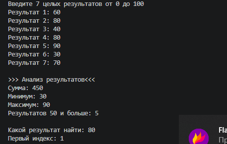

# Практическая работа №17

Автор: Алексеевская Елена
Группа: ИСП-251

## Тема

Алгоритмы обработки массивов.

## Что реализовано

- сумма элементов;

- подсчёт элементов по условию;

- минимум и максимум;

- линейный поиск;

- поиск первого индекса.

## Короткие ответы

1. Почему максимум нельзя всегда начинать с `0`?

Ответ: Если все числа в массиве отрицательные, то "0" окажется больше любого из них, поэтому программа ошибочно примет за максимум число 0. Нужно принимать за начальное значение первый элемент массива

2. Что означает `-1` после поиска индекса?

Ответ: Это сигнал о том, что искомый элемент не был найден, а берут -1, потому что реальные индексы начинаются с 0. Это удобно использовать для обозначения отсутствия сигнала.

3. Чем сумма отличается от подсчёта элементов?

Ответ: При нахождении суммы мы складываем сами значения элементов, а при подсчёте элементов по условию мы увеличиваем счётчик на 1 каждый раз, когда элемент подходит под условие.

## Результат

